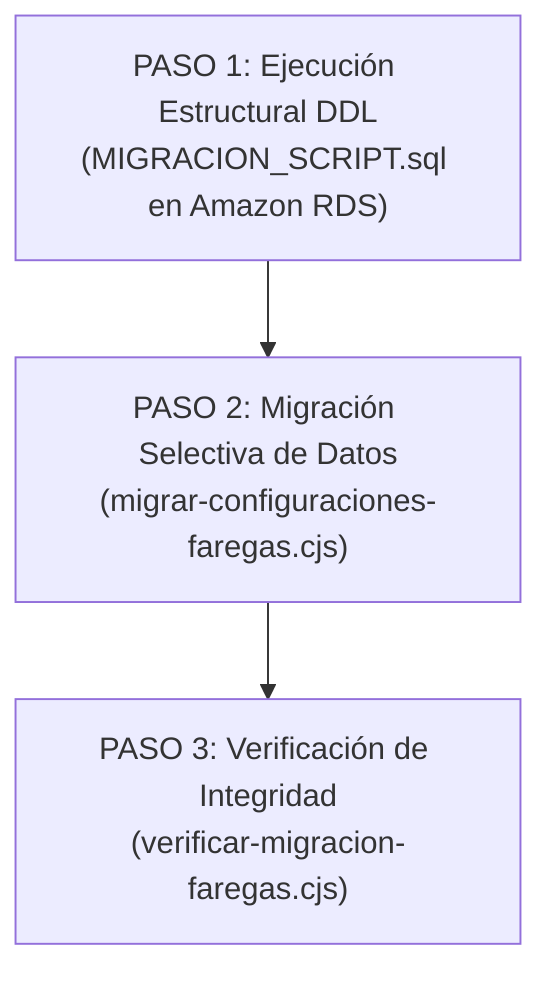

# GUÍA OFICIAL PARA EL DBA: INSTALACIÓN ESTRUCTURAL Y MIGRACIÓN SELECTIVA DE FAREGAS EN AMAZON RDS POSTGRESQL

Este paquete contiene todos los artefactos requeridos para desplegar la estructura de FAREGAS y realizar la migración selectiva de datos de configuración hacia la instancia Amazon RDS PostgreSQL compartida con FARENET, **garantizando el aislamiento absoluto de datos y sin alterar ninguna tabla ni registro de FARENET ni FARECOM**.

---

## 1. Contenido del Paquete

1. **`MIGRACION_SCRIPT.sql`**: Script maestro único de DDL y control de acceso (creación de 74 tablas `fg_*`, secuencias, índices, restricciones, validación fail-fast de dependencias FARENET y políticas de mínimos privilegios para `faregas_app_user`).
2. **`migrar-configuraciones-faregas.cjs`**: Herramienta de migración selectiva basada en Node.js (con DRY-RUN por defecto).
3. **`verificar-migracion-faregas.cjs`**: Herramienta de validación integral post-migración.
4. **`MATRIZ_MIGRACION_TABLAS.md`**: Clasificación exhaustiva de las tablas de origen y su tratamiento.
5. **`CHECKSUMS_SHA256.txt`**: Huellas criptográficas SHA256 de integridad de los archivos entregados.

---

## 2. Flujo de Ejecución del DBA

El proceso se realiza en **TRES PASOS SECUENCIALES**:



---

### PASO 1: Ejecución del Script Maestro DDL (`MIGRACION_SCRIPT.sql`)

* **Responsable:** DBA de Infraestructura.
* **Base de datos objetivo:** Amazon RDS PostgreSQL (base compartida con FARENET, independientemente de su nombre: `inspeccion`, `farenet_db`, `postgres`, etc.).
* **Herramientas recomendadas:** `psql`, DBeaver o pgAdmin.

```bash
# Ejemplo de ejecución mediante psql conectado a Amazon RDS
psql -h <ENDPOINT_RDS_AWS> -p 5432 -U <USUARIO_DBA> -d <NOMBRE_BD_COMPARTIDA> -f MIGRACION_SCRIPT.sql
```

#### Garantías y Mecanismos de Seguridad del Script:
* **Validación Temprana Fail-Fast (Independiente del nombre de BD):** El script verifica en su primera fase la existencia y compatibilidad de los 13 catálogos y tablas maestras requeridas de FARENET (`moneda`, `formapago`, `persona`, `tipodocumentoidentidad`, `pais`, `departamento`, `provincia`, `distrito`, `cuentacorriente`, `entidadfinanciera`, `tarjeta`, `tipocontado`, `seriedocumentobase`). Si falta alguna tabla o columna, aborta inmediatamente con excepción descriptiva y aplica `ROLLBACK` total.
* **Cero DDL sobre FARENET:** FAREGAS NO crea, altera ni elimina estructuras de FARENET.
* **Idempotente y no destructivo:** Seguro para re-ejecución en frío o sobre esquemas parcialmente instalados.
* **Política de Mínimos Privilegios para `faregas_app_user`:**
  - DML completo (`SELECT`, `INSERT`, `UPDATE`, `DELETE`) únicamente sobre tablas con prefijo `fg_*`.
  - Prohibición de `TRUNCATE`, `REFERENCES` y `TRIGGER` para el rol aplicativo.
  - Acceso de **SOLO LECTURA (`SELECT`)** sobre los catálogos y maestros autorizados de FARENET.
  - Prohibición estricta de cualquier permiso de escritura (`INSERT`, `UPDATE`, `DELETE`, `TRUNCATE`) sobre cualquier tabla ajena a `fg_*`.
  - **Protección contra privilegios futuros:** Se revoca `ALTER DEFAULT PRIVILEGES IN SCHEMA public` para `faregas_app_user`. Si en el futuro el DBA o FARENET crean nuevas tablas en el esquema `public`, `faregas_app_user` obtiene **0 privilegios por defecto**.

---

### PASO 2: Migración Selectiva de Configuraciones Maestras

La herramienta traslada desde `192.168.14.19` únicamente las configuraciones reales (sedes, 275 productos con precios editados, 175 tarifas, series, rangos agotados y activos, chips y usuarios), **excluyendo totalmente ventas y certificados de prueba**.

#### A. Simulación Obligatoria (DRY-RUN):
Por defecto, la herramienta corre en modo simulación de solo lectura (sin modificar destino):

```bash
node migrar-configuraciones-faregas.cjs
```

#### B. Ejecución Real Autorizada:
Una vez validados los conteos en el dry-run, el DBA ejecuta la migración proporcionando los parámetros de conexión de destino:

```bash
node migrar-configuraciones-faregas.cjs \
  --ejecutar-autorizado \
  --dest-host=<ENDPOINT_RDS_AWS> \
  --dest-port=5432 \
  --dest-name=<NOMBRE_BD_COMPARTIDA> \
  --dest-user=<USUARIO_DBA> \
  --dest-password='<CONTRASEÑA_DBA>'
```

*O configurando las variables de entorno:*
`DEST_DB_HOST`, `DEST_DB_PORT`, `DEST_DB_NAME`, `DEST_DB_USER`, `DEST_DB_PASSWORD`.

#### Mecanismos de Seguridad del Migrador:
1. **Control de Origen vs. Destino:** El migrador se niega a ejecutarse si el host y la base de datos de origen y destino coinciden.
2. **Transaccionalidad Total:** Ejecuta todo dentro de una transacción `BEGIN / COMMIT`. Ante cualquier excepción, aplica `ROLLBACK` inmediato.
3. **Idempotencia Segura:** Utiliza cláusulas `ON CONFLICT (...) DO UPDATE` / `DO NOTHING`. En series y rangos de certificados utiliza `GREATEST()` para impedir retrocesos de numeración oficial.
4. **Desvinculación de Pruebas:** Establece en `NULL` las claves foráneas que apuntaban a operaciones comerciales de prueba (`operacion_reserva_id`, `operacion_comercial_id`, `certificado_id`).

---

### PASO 3: Verificación de Integridad Post-Migración

Ejecutar la herramienta de verificación sobre la base de Amazon RDS:

```bash
node verificar-migracion-faregas.cjs \
  --target-host=<ENDPOINT_RDS_AWS> \
  --target-port=5432 \
  --target-name=<NOMBRE_BD_COMPARTIDA> \
  --target-user=<USUARIO_DBA> \
  --target-password='<CONTRASEÑA_DBA>'
```

#### Criterios de Aceptación que Valida la Herramienta:
1. **Tablas Maestras Pobladas:** Empresas (14), Sedes (31), Productos (275), Tarifas (175), Usuarios (33), Permisos (50).
2. **Precios Personalizados Intactos:** SKU `0211` en S/ 80.00 y SKU `0439` en S/ 70.00.
3. **Trazabilidad de Certificados:** 64 rangos agotados históricos y 10 rangos activos con saldos disponibles preservados.
4. **Estado de Chips:** 3 disponibles en Sede 160 y 35 en estado `'VENDIDO'` bloqueados contra duplicación.
5. **Cero Transacciones de Prueba:** `fg_operacion_comercial = 0`, `fg_facturacion = 0`, `fg_certificado = 0`, `fg_pago = 0`.
6. **Dashboard Limpio:** La consulta de ventas devuelve 0 registros sin arrojar errores de SQL.

---

## 3. Plan de Contingencia y Rollback

Si el DBA necesita revertir la migración:
1. Las tablas de FARENET no son afectadas en ningún momento.
2. Para reiniciar las tablas de FAREGAS en Amazon RDS a un estado limpio sin tocar FARENET, se puede truncar en cascada exclusivamente el conjunto `fg_*` mediante:
```sql
TRUNCATE TABLE 
    fg_usuario_planta, fg_perfil_planta, fg_tarifa, fg_serie_comprobante,
    fg_correlativo_certificado_sede, fg_correlativo_certificado,
    fg_chip_movimiento, fg_chip, fg_inventario_cantidad_movimiento,
    fg_producto_inventariable_sede, fg_producto_inventariable,
    fg_producto_facturacion, fg_servicio, fg_categoria_servicio,
    fg_usuario_perfil, fg_usuario_credencial, fg_usuario,
    fg_planta, fg_empresa_facturador, fg_empresa
CASCADE;
```
*(Este comando solo afecta a tablas con prefijo `fg_*`; FARENET permanece 100% intacto).*
